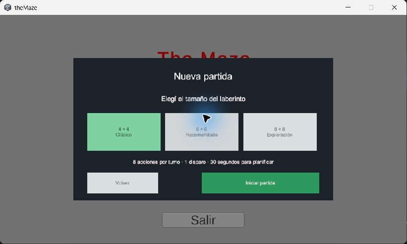
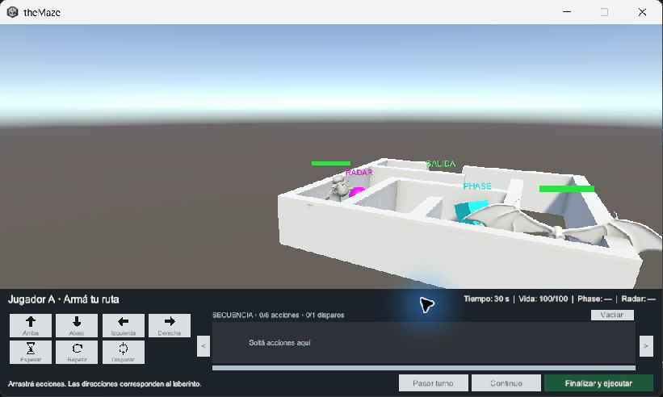
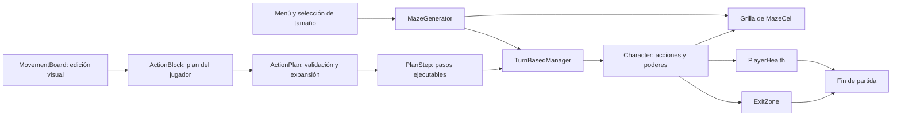

# The Maze

[English](README_EN.md) · Español

**Programar una estrategia, validarla y verla ejecutarse en un laberinto procedural.**

The Maze es un juego local de estrategia por turnos para dos personas, desarrollado con **Unity y C#**. Cada jugador construye una secuencia visual de acciones para llegar a la salida o derrotar a su rival. El escenario cambia en cada partida y las decisiones se ejecutan con reglas explícitas de tiempo, presupuesto y disponibilidad de poderes.

El interés técnico del proyecto está en convertir una intención del usuario en un plan estructurado: editar bloques, validar restricciones y ejecutar pasos sobre un entorno con estado. Es un caso de ingeniería de software que permite explorar algoritmos, modelado de acciones, control de ejecución y calidad de interfaces.

Esta presentación describe la entrega actualizada del **20 de octubre de 2026**.

## Capturas

## La experiencia

1. Elegir un laberinto de 4×4, 6×6 u 8×8.
2. Preparar una ruta en una bandeja de acciones mediante clic o arrastre.
3. Combinar movimientos, espera, disparo y repeticiones anidadas.
4. Validar y ejecutar la ruta, observando su avance paso a paso.
5. Alternar turnos hasta alcanzar la salida o reducir la vida del rival a cero.

Cada turno dispone de 30 segundos, hasta ocho acciones ejecutadas y un disparo. Las repeticiones consumen el presupuesto de las acciones que contienen. Una ruta inválida permanece disponible para corregirla.

Los poderes **Phase** y **Radar verdadero** añaden decisiones sobre cuándo atravesar un muro o consultar la ubicación actual del rival. El radar normal trabaja con información histórica, por lo que la estrategia también depende de información incompleta.

## Decisiones técnicas

| Decisión | Motivo y comportamiento |
|---|---|
| Generación mediante recorrido aleatorio en profundidad | Construir una grilla conectada con recorridos diferentes entre partidas. |
| Separar edición, validación y ejecución | Mantener una representación explícita del plan y comprobarla antes de modificar el entorno. |
| Contabilizar acciones expandidas | Evitar que las repeticiones eludan los límites de movimientos o disparos. |
| Limitar profundidad y cantidad de bloques | Acotar el trabajo del validador y rechazar estructuras inválidas o cíclicas. |
| Una cámara y un panel activos | Concentrar la interacción en el jugador que planifica o ejecuta su turno. |
| Herramientas de diagnóstico solo en desarrollo | Separar los controles de prueba de la versión jugable final. |

## Arquitectura

`ActionPlan` representa y valida el plan; `MovementBoard` resuelve la interacción; `TurnBasedManager` coordina turnos, tiempo y ejecución; `Character` aplica acciones en la grilla. El [diagrama de clases ampliado](docs/assets/arquitectura-clases.svg) muestra también interfaz, audio y herramientas de desarrollo.

## Desarrollo y evolución

El desarrollo original combinó generación procedural, creación de personajes mediante código y control por instrucciones de texto. La actualización de 2026 sustituyó ese editor por bloques visuales, unificó la cámara del turno activo y formalizó la validación de planes.

La bitácora registra un proceso de revisión del comportamiento existente, decisiones de diseño, implementación, revisión independiente y corrección de regresiones. Entre los casos tratados aparecen la pausa del reloj, los editores superpuestos, el arrastre sobre elementos recortados y la publicación de compilaciones sin archivos obsoletos.

El proyecto incluye comprobaciones de planes, integración y regresión de interfaz.

## Desarrollo individual y metodología

Desarrollé The Maze de forma individual, abordando la generación procedural, el modelo de acciones, la validación de planes, las mecánicas y la interfaz. La evolución del proyecto conectó el control mediante instrucciones con una planificación visual y restricciones explícitas de ejecución.

El trabajo siguió un proceso iterativo: definir reglas, separar responsabilidades, implementar el comportamiento, comprobar casos y corregir regresiones. La actualización de 2026 incorporó asistencia de Codex en implementación y documentación, bajo decisiones de diseño y revisión del comportamiento.

## Tecnologías

**C# · Unity 6000.2.2f1 · Universal Render Pipeline · Unity UI · TextMeshPro · Input System · PowerShell**

## Ejecutar y explorar

1. Clonar este repositorio y añadir su carpeta raíz en Unity Hub.
2. Abrirlo con **Unity 6000.2.2f1**. Unity regenerará sus cachés y restaurará los paquetes.
3. Abrir `Assets/Scenes/MENU.unity` y pulsar Play.

Para generar un ejecutable de Windows, usar el menú de compilación de Unity. El código del proceso de build se encuentra en `Assets/Editor/MazeBuild.cs`. El ejecutable y sus dependencias no se almacenan como código fuente en este repositorio.

[Manual de juego](COMO_JUGAR.md) · [Documento de diseño](GDD.md)

## Alcance

The Maze es un juego local. El plan lo construye la persona; su ejecución utiliza reglas deterministas sobre un escenario generado proceduralmente. La representación de acciones, la validación previa y la gestión explícita del estado forman parte del diseño del motor de juego.

El equilibrio competitivo requiere partidas prolongadas entre personas. El proyecto no incluye multijugador en red ni guardado de partidas en curso.

## Créditos

Desarrollo: **Juan Arese**. Los modelos, materiales y recursos incorporados conservan su autoría original. Música: “Lets go back”, de Patrick Patrikios, y “Soaring”, de The Grey Room / Golden Palms. La publicación de código y recursos debe respetar las licencias correspondientes.
