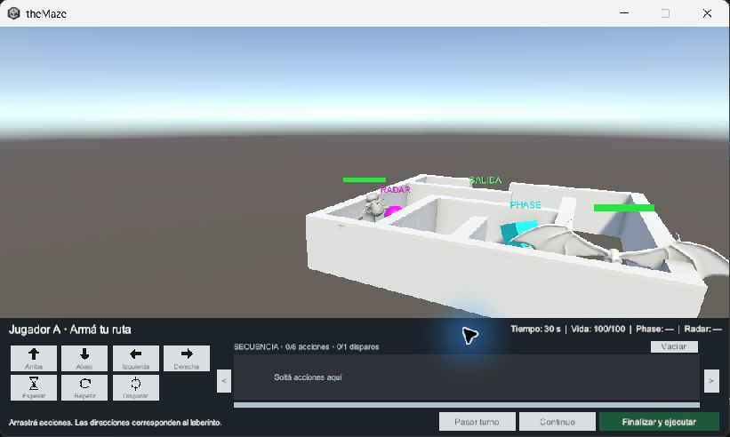

# The Maze

English · [Español](README.md)

A local, turn-based strategy game for two players, built with Unity and C#. Players create visual action sequences to navigate a procedurally generated maze, reach the exit, or defeat their opponent.

Developed individually by **Juan Arese**. This repository contains the updated October 2026 version.

## Features

- Connected procedural mazes in three sizes: 4×4, 6×6, and 8×8.
- Visual action planning with movement, waiting, shooting, and nested repeats.
- Plan validation before execution: eight actions and one shot per turn, with bounded nesting and cycle detection.
- Thirty-second planning turns, player health, exit conditions, and Phase/Radar powers.
- Separate responsibilities for plan representation, validation, user interaction, and turn execution.

## Architecture

`MazeGenerator` builds the grid; `MovementBoard` edits `ActionBlock` plans; `ActionPlan` validates and expands them into steps; `TurnBasedManager` controls execution; `Character` applies movement and powers.

[Class diagram](docs/assets/arquitectura-clases.svg)

## Run locally

Clone the repository, add its root folder to Unity Hub, and open it with **Unity 6000.2.2f1**. Open `Assets/Scenes/MENU.unity` and enter Play mode. Unity regenerates caches and restores packages on first launch.

The source includes plan checks and development-only integration/regression runners. Their presence is not a claim that all checks were rerun for this publication.

## Scope and credits

Local multiplayer; no network multiplayer or mid-game saves. Development followed an iterative process of rule definition, implementation, checking, and regression fixes. The 2026 update used Codex assistance for implementation and documentation.

Third-party assets retain their original authorship and terms. Music: “Lets go back” by Patrick Patrikios and “Soaring” by The Grey Room / Golden Palms. Code authorship does not imply ownership of these assets.
